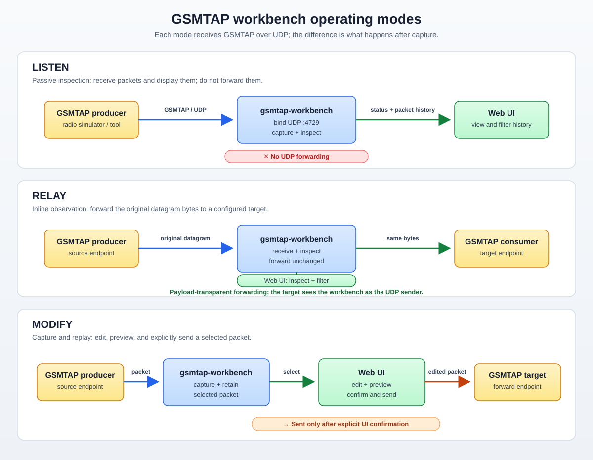
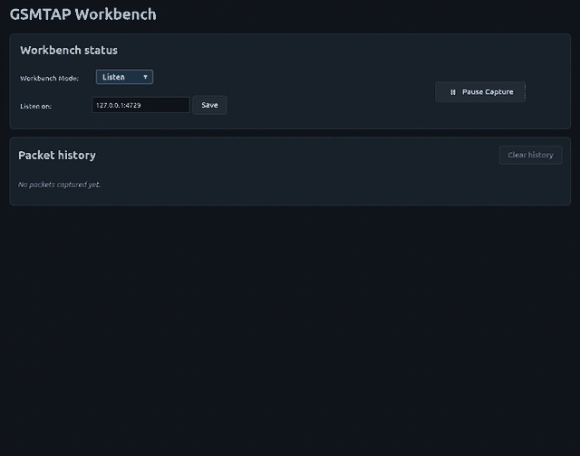
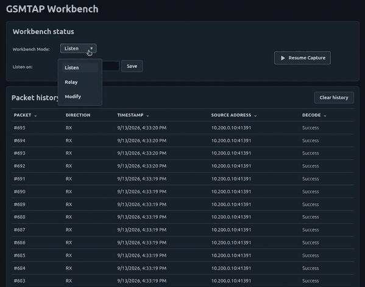

# gsmtap-rs

`gsmtap-rs` is a Rust implementation of GSMTAP packet parsing and encoding.

## Building

This project requires Rust 1.99 or newer. To build it, run:

```bash
cargo build
```

The optional `osmocore` feature adds the workbench conversion panels, backed by
[osmocore-rs](https://github.com/Silent-Wolf-Labs/osmocore-rs). Until
osmocore-rs is published, it is a path dependency on a sibling checkout at
`../libosmocore-rs/osmocore-rs`:

```bash
cargo build --features osmocore
```

## Testing

To run tests, execute:

```bash
cargo test
cargo test --features osmocore
```

## Live web workbench

Build and run the single-process workbench with:

```bash
cargo run --features osmocore --bin gsmtap-workbench
```

Without `--features osmocore`, the workbench serves only the packet views.

Open `http://localhost:8080`. Use the status card to change the GSMTAP listen
address, choose the operating mode, and set a forward target when Relay or
Modify mode is active.

[](https://youtu.be/k0_CIiQXFq0)

Watch the [GSMTAP workbench demo](https://youtu.be/k0_CIiQXFq0) on YouTube.

### Local interactive demo

To send continuous sample traffic to an isolated local address, create the
dummy interface below, start the workbench, and run the traffic generator in a
second terminal:

```bash
sudo ip link add gsmtap-demo type dummy
sudo ip addr add 10.200.0.10/24 dev gsmtap-demo
sudo ip link set gsmtap-demo up
python3 tests/traffic/continuous.py
```

To demonstrate Relay or Modify mode with a downstream UDP service on the same
host, assign a second address before starting the demo:

```bash
sudo ip addr add 10.200.0.20/24 dev gsmtap-demo
```

Set **Listen on** to `10.200.0.10:4729` and **Forward to** to
`10.200.0.20:4729`. The downstream application must bind a UDP socket to
`10.200.0.20:4729`; relay sends selected packets there, while modify sends
explicit replays and edited packets there.

The generator sends to `10.200.0.10:4729` by default. Stop it with `Ctrl-C`,
then remove the temporary interface when finished:

```bash
sudo ip link delete gsmtap-demo
```

The container image exposes TCP port 8080 and UDP port 4729:

```bash
docker build -t gsmtap-workbench .
docker run --rm -p 8080:8080 -p 4729:4729/udp \
  gsmtap-workbench
```

The browser only calls the application API. GSMTAP parsing and encoding remain
implemented by the Rust library.

The **Workbench view** selector opens Hexparse, BCD, Bits, and Base64
conversion forms. Hexparse, BCD, and Bits support conversion, buffer comparisons, and copy
controls; Base64 supports encoding, decoding, and decoded-size probes. See [Conversion UI review](docs/conversion-ui.md).
These panels require the `osmocore` feature, which the Docker image enables.
Until osmocore-rs is published to crates.io, Docker and CI builds cannot resolve
its path dependency.

### Operating modes

The workbench has three operating modes. The web UI is available in every
mode: listen and relay provide inspection, while modify additionally provides
explicit edit, preview, and send controls.



Start the workbench once; it opens in Listen mode at `http://localhost:8080`.
Choose Relay or Modify from the **Workbench Mode** control when needed, then
enter the forward target in the UI. When using Docker, publish UDP port `4729`
as shown above.

#### Listen mode: inspect traffic

Listen mode is the default. It receives and retains packets for inspection but
never forwards them. Use it to observe a GSMTAP source safely.

Use **Pause Capture** in the status card to temporarily stop accepting incoming
datagrams; select **Resume Capture** to begin receiving them again. Existing
history remains available while capture is paused.



#### Relay mode: inspect and forward selected packets

Relay mode records incoming datagrams without automatically forwarding them.
Select one or more packets in the UI, then choose **Forward selected**. The
workbench sends the original bytes to the forward target configured in the UI;
the target sees the workbench host or container as the UDP source.


#### Modify mode: capture, edit, preview, and send

Modify mode retains incoming packets for later replay or editing. Select a
decoded received packet, change its editable fields, choose **Preview changes**,
and then choose **Confirm and send** to send the edited copy to the configured
target. Incoming traffic is never held while an operator edits a packet.


#### Change mode or listen address in the UI

The status card can change modes without restarting the application. Select
**Workbench Mode**, choose **Relay** or **Modify**, enter a `host:port` forward
target, and select the activation button. Switching back to Listen removes the
active forward target. Packet history and capture state are preserved.



The **Listen on** field changes the active GSMTAP UDP listener without a
restart. Enter an IPv4 `address:port` and select **Save**. The address must
exist on a host network interface; the HTTP listener remains configured at
startup.


For mode-by-mode use cases, see
[Mode use cases](docs/mode-use-cases.md).

The service retains only a bounded, oldest-first history (default 10,000
packets), while the UI renders a recent 500-packet page and can later select
one packet to replay or modify.
`/api/status` reports receive, parse,
ingress-drop, history-eviction, and UI-event-drop counters.

The workbench is intended for trusted lab or development traffic. It retains
packet content in memory for inspection, so do not expose it directly to
untrusted high-volume networks without applying deployment-specific bounds and
access controls.

For a local container smoke check, start the image, open
`http://localhost:8080`, and select the intended mode from the status card.
Listen mode must not forward received packets; relay mode records received
packets and forwards only the packets selected with the UI's Forward selected
action; modify mode requires using the UI's Preview changes and Confirm and
send controls. GitHub Actions runs
formatting, linting, tests, a release build, security checks, and Docker
integration checks on pushes and pull requests. Releases are created from
matching semantic-version tags such as `v0.1.1`: the crate is published to
crates.io, and the supported workbench image is published to
`ghcr.io/silent-wolf-labs/gsmtap-rs:0.1.1`. Stable releases also update the
`latest` tag; prereleases do not. GitHub Releases include the CycloneDX SBOM
and SHA256 checksums. CI also builds both container targets and runs isolated
listen, relay, and modify traffic checks.

### Reference-vector traffic checks

Build the slim Python traffic image with:

```bash
docker build --target traffic-test -t gsmtap-traffic-test .
```

It replays every committed `tests/vectors/*.json` `encoded_hex` value as
opaque bytes generated by the libosmocore reference harness. It does not
implement GSMTAP encoding. CI checks listen, byte-preserving relay (including
a malformed datagram), and modify-mode preview, replay, and explicit send.
The same checks can be run locally with Docker Compose. These automated cases
set an initial mode through `GSMTAP_MODE` so each workflow can be tested in
isolation:

```bash
GSMTAP_MODE=listen docker compose -f tests/integration/compose.yaml up --build --abort-on-container-exit --exit-code-from traffic
GSMTAP_MODE=relay docker compose -f tests/integration/compose.yaml up --build --abort-on-container-exit --exit-code-from traffic
GSMTAP_MODE=modify docker compose -f tests/integration/compose.yaml up --build --abort-on-container-exit --exit-code-from traffic
docker compose -f tests/integration/compose.yaml down --remove-orphans --volumes
```

Each invocation is an isolated Compose project with one workbench and one
traffic verifier service.
The verifier is the test assertion: it confirms receive counts through the
status/API, checks explicitly batch-forwarded relay datagrams byte-for-byte,
monitors the listen sink for unexpected forwarding, and validates modify
preview/replay/send effects.

For direct local checks, use the mode-specific scripts. For example, start the
workbench, select Relay in the status card, set its forward target to
`127.0.0.1:9000`, then run:

```bash
python3 tests/traffic/relay.py \
  --workbench-host 127.0.0.1 \
  --workbench-port 8080 \
  --listen-port 4729 \
  --sink-port 9000 \
  --vectors tests/vectors
```

`tests/traffic/listen.py` and `tests/traffic/modify.py` provide equivalent
checks for those modes. `replay.py --mode …` remains available for Compose and
automation compatibility.

## License

This project is licensed under the Apache License, Version 2.0. See
[LICENSE](LICENSE) for the full text.

The optional `osmocore` feature links osmocore-rs, which is licensed under
GPL-3.0-or-later. Binaries and container images built with that feature,
including the published Docker image, are distributed under GPL-3.0-or-later as
a whole.

## Message-buffer stage 1

The dedicated `tests/vectors/msgb/msgb_vectors.json` contains 3,695 direct C
operation records, with full backing bytes before/after, data/tail offsets,
length/capacity, layer markers, control words, destination/channel presence,
query results, and normalized panic/error outcomes. The fixture is identical to
`../libosmocore-rs/osmocore-rs/tests/compatibility/vectors/msgb_vectors.json`.
The shared `tests/support/msgb_fixture.rs` validator is identical to the
conversion crate's `tests/support/msgb_fixture.rs`. Tests freeze schema, inputs,
order, provenance, ABI, state consistency, sequence continuity, and corruption
rejection. Normal Cargo tests consume committed JSON without building C.

`reference/msgb_vector.c` calls the actual APIs, including inline primitives.
`reference/run_msgb_vector.sh` pins msgb source/header/upstream tests and panic
source/header, rebuilds the required local core library, and selects it at link
and runtime. All five files were compared byte-for-byte with upstream revision
`950430e829a3dc1d162aa241bc0505745c5a7311` on 2026-10-08. The runner contains
the verified SHA-256 hashes. It fails on missing/mismatched source or unsupported
ABI instead of falling back. The ABI is 8-bit bytes, 32-bit unsigned int,
64-bit unsigned long, and 64-bit pointers.

Coverage includes all offsets/lengths for capacities 0, 1, and 2; selected
zero/half/full offsets and lengths for capacities 8 and 16; zero/exact/excess
arguments; nonzero headroom; trim extension/shrinkage; guarded panic cases;
all optional-layer combinations; reset preservation; reuse sequences; and
65,535-byte capacity. Every before/after state directly queries data, length,
headlen, headroom, tailroom, and invariant. The operation-record count excludes
setup calls and these queries. Head is always zero; pointers are offsets or
null (`-1`). Destination/channel fields record presence, never addresses.
A controlled panic handler uses setjmp/longjmp as in upstream tests.
Void/allocation/invariant observations use return sentinel `-1`; `panic`
distinguishes aborts. Allocation snapshots record actual C zero initialization.

No unsafe C trim with headroom, nonempty reserve, invalid offsets, or NULL
access is used to generate evidence. Rust-only safety tests live in the
conversion repository. That crate owns fixed-capacity storage up to 65,535,
returns checked errors and pointer offsets, and preserves C's wrapping headlen
and reset behavior (L1 and bytes survive; L2–L4 and control words clear).
It checks trim against remaining storage after data and reserve against an
empty message. Fixed `u64` control words match the recorded ABI. Raw
channel/destination pointers and talloc contexts are excluded. Rust allocation
failure follows standard allocator behavior rather than C's NULL return.

Stage 1 covers data/length, headlen/headroom/tailroom, reserve, put/get,
push/pull, trim, reset, invariant, and basic construction/drop equivalents.
Stages 2–3 below add typed/layer helpers and copy/resize. Stage 4 below covers
queues, equality, hex dumps, formatted append, and the context adapter inventory. No msgb endpoint,
GSMTAP-loader integration, or vendored crate snapshot refresh is included.

Regenerate and validate from this repository root:

```bash
./reference/run_msgb_vector.sh > /tmp/msgb_vectors.fresh.json
cmp /tmp/msgb_vectors.fresh.json tests/vectors/msgb/msgb_vectors.json
cmp tests/vectors/msgb/msgb_vectors.json ../libosmocore-rs/osmocore-rs/tests/compatibility/vectors/msgb_vectors.json
cmp tests/support/msgb_fixture.rs ../libosmocore-rs/osmocore-rs/tests/support/msgb_fixture.rs
./scripts/generate-reference-vectors.sh
cargo fmt --check
cargo test
git diff --check
```

The full generator can reformat legacy packet JSON: compare semantics and
restore unrelated formatting before accepting the diff. Case IDs, input/order,
schema, and count are frozen; changing the contract requires explicit review.

## Message-buffer typed and layer helpers (stage 2)

Stage 2 adds 25 C entry points to `core::msgb`: `msgb_put_u8/u16/u32`,
`msgb_push_u8/u16/u32`, `msgb_get_u8/u16/u32`, `msgb_pull_u8/u16/u32`,
`msgb_l1/l2/l3/l4`, `msgb_sms`, `msgb_l1len/l2len/l3len/l4len`,
`msgb_pull_to_l2`, `msgb_pull_to_l3`, `msgb_l3trim`, and `msgb_push_tl`.
The slash notation expands the related names, e.g. `msgb_put_u16`.
All typed multi-byte operations use big-endian order. Writes return `Result<()>`;
reads return the corresponding unsigned value. Bytes outside written spans
remain unchanged, including bytes removed by typed get/pull operations.

Layer access returns `Option<usize>` backing offsets; SMS aliases L4. Layer
lengths return `Result<u32>`, preserving C's unsigned wrapping subtraction when
a marker is beyond tail, even outside active data. Missing markers return
`MsgbError::MissingLayer` instead of C assertion panics. Pull-to-L2 clears L1;
pull-to-L3 clears L1/L2. Both require a marker in `[data, tail]`, inclusive,
and preserve all state on errors (`MissingLayer` or `LayerOutsideMessage`).

L3 trimming sets total length to `(L3 - data) + l3len`, using a signed
calculation. Negative requested L3 lengths are accepted when the resulting
total is nonnegative. Markers before data or beyond tail may participate in
this defined calculation. Rust rejects missing L3, totals outside signed
32-bit range (`ArithmeticOverflow`), negative totals (`NegativeLength`), and
tails beyond backing storage (`NotEnoughTailroom`), without mutation. C
narrowing outside the signed-int range and NULL pointer subtraction are not
portable fixture cases.

Tag/length prepending adds two bytes: the tag and the prior message length
narrowed to eight bits, including wrap for lengths above 255. It returns the
new data offset. Headroom errors do not write either byte.

A separate 7,572-record C fixture, `msgb_layers_vectors.json`, captures complete
before/after storage and metadata, queries, return values, and panic outcomes.
It covers all 256 u8 values for all four typed operations; u16/u32 boundary
values and high-bit results; exact/insufficient room and message lengths;
layer markers in headroom, active data, and tailroom or unset; wrapping layer
lengths; successful and failed pull-to-layer; signed L3 trim boundaries;
tag and length wrapping; and a 14-step mixed sequence. It shares schema helpers
with stage 1, whose 3,695 records remain byte-for-byte unchanged. Across the two
stages there are 11,267 operation records, excluding setup and snapshot queries.

Successful C u16/u32 pushes use aligned destinations: the C wrappers cast to
typed pointers before byte stores. Rust uses byte slices and supports unaligned
pushes; that extension has separate Rust-only tests. The C fixture excludes
unsafe NULL subtraction, out-of-storage trim, and implementation-defined signed
narrowing. Both projects validate exact schema/provenance/input order, untouched
bytes, typed byte order, query consistency, metadata changes, and corrupt records.
The conversion crate compares Rust results against C and tests safety differences.

The runner's `--layers` mode additionally pins `bits.h`, `utils.h`, the endian
header template, its `Makefile.am` generation rule, and generated `bit16gen.h`
and `bit32gen.h`. The template/rule/bits/utils files were compared byte-for-byte
with upstream revision `950430e829a3dc1d162aa241bc0505745c5a7311` on 2026-10-08.
The generated headers were reproduced from that template using the verified
`XX` replacement rule and compared byte-for-byte. Their SHA-256 hashes are
pinned in the runner and recorded in each observation. Headers/library still
come exclusively from the required local C checkout.

Stages 1–3 cover storage, typed/layer helpers, and copy/resize.
Stage 4 below completes the adapter inventory with explicit exclusions. GSMTAP consumers, endpoints, and the vendored snapshot are unchanged.

From this repository root, regenerate and verify:

```bash
./reference/run_msgb_vector.sh --layers > /tmp/msgb_layers.fresh.json
cmp /tmp/msgb_layers.fresh.json tests/vectors/msgb/msgb_layers_vectors.json
cmp tests/vectors/msgb/msgb_layers_vectors.json ../libosmocore-rs/osmocore-rs/tests/compatibility/vectors/msgb_layers_vectors.json
cmp tests/support/msgb_layers_fixture.rs ../libosmocore-rs/osmocore-rs/tests/support/msgb_layers_fixture.rs
./scripts/generate-reference-vectors.sh
cargo fmt --check
cargo test
git diff --check
```

The stage-2 validator in `tests/support/msgb_layers_fixture.rs` uses shared
`msgb_fixture.rs` schema helpers. Both files and both msgb fixtures match the
conversion repository byte-for-byte. `tests/msgb_layers_reference_vectors.rs`
validates structure and corruption rejection; it does not implement Rust APIs
or generate expected outputs. All new fixtures stay outside packet/replay loaders.

## Message-buffer copy and area resize (stage 3)

`core::msgb` adds `msgb_copy(&Msgb) -> Result<Msgb, MsgbError>`,
`msgb_copy_resize(&Msgb, capacity: usize) -> Result<Msgb, MsgbError>`, and
`msgb_resize_area(&mut Msgb, area: usize, old_size: i32, new_size: i32)` returning
`Result<(), MsgbError>`. The two copy functions also represent the buffer
behavior of C's `msgb_copy_c` and `msgb_copy_resize_c`; Rust ownership replaces
context/name arguments rather than reproducing talloc context semantics.

Copies preserve active bytes, data/tail offsets, and optional L1–L4 offsets.
The local C implementation copies only active bytes despite its broader
comment: headroom and unused tailroom bytes in the new allocation are zero.
Control words and raw destination/channel metadata are cleared in C; Rust
clears its control words and has no raw pointer metadata. Copy storage is owned
independently of the source. New capacity includes headroom and must hold the
current tail; Rust also requires preserved layer offsets within that capacity.
Failed copies leave the source unchanged. Rust allocation failure retains the
standard allocator policy rather than C's NULL allocation-failure return.

Area resize accepts an absolute backing offset, requires the old area fully
inside `[data, tail]`, and moves its suffix using memmove semantics. Layer
markers at or after `area + old_size` move by `new_size - old_size`, including
markers in unused storage. Markers inside the removed area remain unchanged,
even if they subsequently lie beyond tail or violate layer ordering. Control
words and C destination/channel metadata are preserved. Zero-size insertion,
whole-message removal, overlap in both directions, and no-op resize are covered.

Growth does not initialize the extension; shrinkage does not erase the unused
suffix. Observations of initialized buffers retain all bytes outside the moved
suffix's destination. This does not promise generally zero-filled extension
contents. Rust checks active storage bounds and every relocated layer before
mutation, rejects negative sizes, and leaves all state unchanged on errors.
A marker that would move beyond backing storage produces `OffsetOutOfRange`;
an old area outside active data produces `AreaOutsideMessage`.

The separate `msgb_resize_vectors.json` holds 8,888 direct C records: 1,131
copy calls across all four wrappers and 7,757 area-resize calls. Successful
copies record both unchanged source state and the complete new buffer, with
pointer identity reduced to a distinct-storage flag. NULL copy results are
explicit (`copy_present=0`), with absent-state sentinels. Resize calls record
before/after bytes, offsets, all layer/control metadata, queries, return codes,
and guarded panics. Inputs/order/schema/provenance and corruption rejection
are validated identically in both projects. All three msgb fixtures total
20,155 operation records; the first two fixtures remain byte-for-byte unchanged.

The C harness excludes pointer arithmetic beyond either allocation, NULL
relational comparisons during mutating resize, and growth that would exploit
C trim's incomplete headroom check. Negative-size panic cases keep C's
pre-check pointers within backing storage. Rust-only tests cover unset layers,
unsafe shrink-copy layer offsets, unsafe growth/relocation, extreme arguments,
copy independence, and preservation of unwritten bytes and removed-area markers.

`reference/run_msgb_vector.sh --resize` pins the existing msgb/panic reference
plus local logging source/header and the assertion header. Logging is initialized
without targets so legitimate copy-failure logging does not cause an unrelated
panic. The logging files were verified byte-for-byte against upstream revision
`950430e829a3dc1d162aa241bc0505745c5a7311` on 2026-10-09; the assertion header
was already verified on 2026-10-08. The fixture ABI additionally records 32-bit
signed int. The runner builds, links, and loads only the required local checkout.

Stages 1–3 cover storage, typed/layer helpers, and copy/resize.
Stage 4 below completes the adapter inventory with explicit exclusions. GSMTAP consumers, endpoints,
and the sibling vendored crate snapshot remain unchanged.

From this repository root:

```bash
./reference/run_msgb_vector.sh --resize > /tmp/msgb_resize.fresh.json
cmp /tmp/msgb_resize.fresh.json tests/vectors/msgb/msgb_resize_vectors.json
cmp tests/vectors/msgb/msgb_resize_vectors.json ../libosmocore-rs/osmocore-rs/tests/compatibility/vectors/msgb_resize_vectors.json
cmp tests/support/msgb_resize_fixture.rs ../libosmocore-rs/osmocore-rs/tests/support/msgb_resize_fixture.rs
./scripts/generate-reference-vectors.sh
cargo fmt --check
cargo test
git diff --check
```

`tests/msgb_resize_reference_vectors.rs` validates the frozen schema/coverage
and corruption rejection through `tests/support/msgb_resize_fixture.rs`, which
matches the conversion crate byte-for-byte. Fixture directories remain separate
from packet/replay loaders. Expected observations come only from direct C calls.
Review full regeneration and restore unrelated formatting-only fixture changes.

## Message-buffer remaining adapters (stage 4)

Stage 4 completes the planned conversion and adapter inventory. Rust queues
own their messages in `MsgbQueue` (`VecDeque<Msgb>`): `msgb_enqueue`,
`msgb_dequeue`, `msgb_queue_free`, `msgb_enqueue_count`, and
`msgb_dequeue_count` preserve FIFO order. Counted operations use a separate
caller-owned `u32` with wrapping arithmetic; an empty dequeue and queue free
leave that counter unchanged. Moving a message transfers ownership, and
queue free drops queued buffers. Rust does not expose intrusive links or allow
the same owned message to be enqueued twice.

`msgb_eq_data` / `msgb_eq_l1_data` through `msgb_eq_l4_data` compare slices;
`msgb_eq` / `msgb_eq_l1` through `msgb_eq_l4` compare messages. They return
`Result<bool, MsgbError>`. `msgb_eq_level` selects levels 0–4, and
`msgb_eq_optional` returns false for absent message/data inputs, matching
C NULL comparisons. Empty slices remain present inputs. Headroom layer bytes
are comparable. Unset or beyond-tail layer comparisons return checked errors;
C's pointer subtraction and potentially enormous wrapped lengths are excluded.

`msgb_hexdump_buf(&mut [u8], &Msgb)` returns a success boolean in place of C's
buffer pointer or `"ERROR"`, preserving defined truncation, NUL writes, and
untouched suffix bytes. `msgb_hexdump` returns an owned `String` with C's
4100-byte output limit. `msgb_hexdump_owned` models `msgb_hexdump_c` using
`length * 3 + 100` bytes without talloc. These retain the underlying
`osmo_hexdump` limit of 1365 input bytes **per segment** and C's layer
annotations, including markers in headroom, behind an earlier marker, or
beyond tail. `msgb_hexdump_l1` through `msgb_hexdump_l4` return `"[]"` for
unset/empty layers and errors for beyond-tail markers. Rust safely checks
short annotation writes where C fails to check `snprintf` truncation; those
unsafe C buffer sizes are excluded from observations. Out-of-allocation layer
pointers cannot be represented by Rust, so C's corresponding annotation has
no callable Rust case.

`msgb_printf(&mut Msgb, format_args!(...))` uses Rust formatting;
`msgb_append_str` appends already formatted UTF-8 bytes. The byte-storage
contract matches C: a spare NUL byte is required, that NUL is outside active
data, and embedded NUL bytes count toward message length. On insufficient
space, it returns `NotEnoughTailroom` (C `-EINVAL`), preserves offsets/layers/
control metadata, and writes truncated output plus NUL into available unused
tail bytes. With no tailroom, no bytes change. This is the documented
exception to the other mutating APIs' unchanged-on-error rule. Rust format
syntax, formatting errors, and allocation failures are not C variadic/locale
formatting compatibility claims.

The explicit allocation and context inventory is:

| C entry points / adapters | Rust equivalent or exclusion |
| --- | --- |
| `msgb_alloc`, `msgb_alloc_c` | `Msgb::new`; zero-initialized owned storage, maximum `u16::MAX`. Names, parent contexts, talloc reporting, and C NULL-on-allocation-failure behavior are excluded; Rust allocation follows its allocator policy. |
| `msgb_alloc_headroom`, `msgb_alloc_headroom_c` | `Msgb::with_headroom`; capacity includes headroom. Excess headroom is an error instead of C assertion/panic. Context/name arguments are excluded. |
| `msgb_free`, `msgb_queue_free` | Rust drop and explicit queue clear/drop. No shared talloc tree lifetime or intrusive linkage. |
| `msgb_copy`, `msgb_copy_c`, `msgb_copy_resize`, `msgb_copy_resize_c` | Stage-3 owned copies preserve the tested buffer semantics. Context/name variants share the Rust owned entry points. |
| `msgb_hexdump_c` | `msgb_hexdump_owned`; owned string replaces talloc output/context. |
| `msgb_set_talloc_ctx`, `msgb_talloc_ctx_init` | Excluded. Rust has no global talloc root or pool; no process-global allocation state is introduced. |
| `_msgb_eq` source-location/print arguments; `msgb_eq_data_print`, `msgb_eq_l1_data_print` through `msgb_eq_l4_data_print` | Comparison behavior is represented by the checked equality helpers. Fatal logging, source locations, and print side effects are excluded. |
| C destination/channel pointers and list links | Excluded from owned `Msgb`; control words remain fixed 64-bit values matching the fixture ABI. |

The separate `msgb_adapters_vectors.json` contains **4,055 direct C records**:
450 slice comparisons (including NULL inputs), 270 message comparisons,
2,942 caller-buffer dumps, 62 static and 62 allocated dumps, 152 layer dumps,
90 formatted appends, and 27 queue operations. Across all four stages there
are **24,210** operation records. Cases cover zero capacity/empty data,
nonzero headroom, full buffers, exact dump size thresholds, reordered/unset
layers, 1364/1365/1366-byte dump limits, 3000-byte segmented output, FIFO
sequences, and unsigned counter underflow/overflow.

The shared `msgb_adapters_fixture.rs` validates strict schema, frozen input
coverage, ABI/source provenance, complete backing and metadata snapshots,
queue state/counters, equality outcomes, append writes, and dump destination
integrity. A frozen FNV-1a fingerprint of the direct C file additionally
rejects all changes to observed output bytes; it is an integrity check, not a
cryptographic authenticity claim. Corruption tests cover missing/duplicate/
unknown fields, provenance, ABI, outcomes, backing bytes, dump output,
counters, and missing records. Rust conformance checks every record; separate
safety tests exercise unsafe C annotation sizes and invalid layer spans.
Ordinary Cargo tests require no C installation.

`reference/run_msgb_vector.sh --adapters` uses only the required local C
checkout. It additionally pins `src/core/utils.c`, `utils.h`, and `linuxlist.h`;
new source/list dependencies were verified byte-for-byte against revision
`950430e829a3dc1d162aa241bc0505745c5a7311` on 2026-10-09. The queue harness
uses GNU C11 because the upstream list macros use `typeof`. Its libtalloc
link supplies the existing C library's allocation dependency. Fixtures and
validators are shared byte-for-byte between repositories.

All four planned stages are complete with the explicit exclusions above;
this is not a claim of talloc, logging, raw-pointer, or C printf ABI parity.
GSMTAP consumers, endpoints, and the vendored crate snapshot are unchanged.
No snapshot refresh is required for these independent conformance fixtures.

Regenerate stage 4 from the testing repository:

```bash
./reference/run_msgb_vector.sh --adapters > /tmp/msgb_adapters.fresh.json
cmp /tmp/msgb_adapters.fresh.json tests/vectors/msgb/msgb_adapters_vectors.json
cmp tests/vectors/msgb/msgb_adapters_vectors.json ../libosmocore-rs/osmocore-rs/tests/compatibility/vectors/msgb_adapters_vectors.json
cmp tests/support/msgb_adapters_fixture.rs ../libosmocore-rs/osmocore-rs/tests/support/msgb_adapters_fixture.rs
```

`./scripts/generate-reference-vectors.sh` includes all four msgb runners.
When intentionally revising C cases, review every changed observation and
update the frozen input manifest/count/fingerprint from direct C output.

## Primitive compatibility evidence

The reference harness also covers generic `libosmocore` primitives: header
initialization/reinitialization, raw SAP/primitive/operation values, operation
names, packed IDs, message association/preservation, ordered event maps, and
callback mutation. The 6,865 direct C observations and shared strict fixture
validator live under `tests/vectors/prim/` and `tests/support/prim_fixture.rs`.
See [reference instructions](reference/README.md#primitive-observations) for
provenance and deterministic regeneration. This adds independent fixture
support; the vendored crate snapshot is refreshed only from a reviewed commit.

## Core CRC compatibility evidence

The direct C harness covers byte CRC-16/CCITT and generic parameterized CRC
8/16/32/64, with 26,320 observation records under `tests/vectors/crc/` and
strict shared validation in `tests/support/crc_fixture.rs`. Golden fixtures
exclude undefined C shifts; a separate UBSan audit establishes that boundary.
See [reference instructions](reference/README.md#core-crc-observations) for
provenance and deterministic regeneration. Protocol-specific parity/channel
and convolutional APIs remain outside this scope. Fixture support requires no
vendored crate snapshot refresh.

## Generic convolutional decoder evidence

The conversion repository now implements checked convolutional descriptors,
signed length helpers, independent capacities, reusable/one-shot encoding and
the generic stateful squared-error decoder, portable scalar correlation via
`osmo_conv_decode_acc` and public one-shot `osmo_conv_decode` dispatch. Both
one-shot APIs take `(&ConvCode, &[i8], &mut [u8])` and return
`Result<i32, ConvError>`: correlation returns `Ok(0)`, generic dispatch returns
accumulated error bounded by `MAX_AE`. `K=5/7 && N<=4` selects correlation,
including `N=1` rejection without fallback. Correlation requires `N=2..=4`
and positive lengths and uses the approved CPU-independent scalar `>=` tie
choice, without Rust SIMD selection or NEON parity. This utility validates
the frozen C evidence,
not the Rust decoder, and does not expose a convolutional workbench endpoint or
refresh its vendored Rust snapshot in this stage.

`ConvDecoder::new(&code, len: i32, start_state: i32)` returns a checked decoder.
Its stateful API is `reset(start_state)`, `rewind()`,
`scan(input: &[i8], symbols: usize)`, `flush(input: &[i8])`,
`best_end_state() -> Result<usize, ConvError>` and
`get_output(output: &mut [u8], has_flush: bool, end_state: i32) -> Result<u32, ConvError>`.
All seven callable C-named stateful wrappers are available; `Drop` replaces
deinit. Scan/flush return consumed soft-byte counts; traceback returns a
squared-error metric, not BER or correlation status.

Negative starts enable all states, starts below `state_count` select one, and
equality deliberately disables all survivors (C reset safely uses an equality
loop). Larger nonnegative starts return `InvalidState`; nonnegative end selectors
must be strictly below `state_count`. Generic decoding accepts `N=1..=31`, with
zero byte masks above eight; descriptor state counts use `K=1..=31`, but
predecessors remain bytes. Metrics use `u32` with signed C `INT_MAX` arithmetic
bounds and strict `MAX_AE=0x00ffffff` survivor cutoff. Both `len + K - 1` and
total history cells must fit `INT_MAX`; failed fallible reservations report
`AllocationFailed`. State, operation, slice, missing/unreachable history,
no-survivor, allocation and overflow errors leave state/output unchanged.
Semantic accessors expose counters, active errors, optional initialized scratch
errors and `Option<u8>` active predecessor history; scan/flush input-capacity
helpers use the current puncture cursor.

`ConvCode::decode_input_capacity()` returns checked actual soft-byte sizing,
counting encountered punctures without the encoder's short tail-biting loading
restriction. Nonsystematic recursion maps to `UnsupportedRecursiveCode` (C
`-EPROTO`); negative traceback statuses map to `NoSurvivor`. All `i8` values,
including `-128`, are supported; selected `i16` metric/normalization differences
outside range return `ArithmeticOverflow`. One-shot dimension, slice, allocation,
arithmetic and traceback errors preserve the entire output; success preserves suffixes.

The unchanged 36,254-record matrix includes 332 generic stateful cases with
7,257 lifecycle observations (6,593 callable API observations plus 664 drops).
The shared reader remains byte-identical to the conversion repository. See
the conversion repository's `tests/conv/conv_correlation.rs` for independent
final-stage replays: 6,796 direct correlation records (1,699 per backend) and
6,608 public dispatch records (1,652 per backend), totaling 13,404 complete
buffer, status/metric and unchanged-input comparisons across linked/scalar/SSE/AVX.
Final-stage provenance verification, isolated scalar/SSE/AVX sanitizer audit
and two 36,254-record regenerations passed, matching both fixtures and each other;
shared reader/manifest comparisons passed too. Frozen evidence and harnesses
remain unchanged. Final full suites passed: conversion repository 130 tests
(64 unit, 65 core integration, one GSMTAP integration) and this utility 85.
Actual final-stage tools were Rust/Cargo 1.97.1 and Clippy 0.1.97, regardless
of misleading `1.85.0` directory labels. CI Rust 1.70 was not tested locally;
all-target Clippy added no correlation diagnostics and known global warnings
remain unchanged. See
[reference instructions](reference/README.md#convolutional-evidence-and-backend-gate)
for non-destructive provenance, ASan/UBSan and twice-regenerated full-matrix
comparisons, and the sibling
[compatibility boundary](../libosmocore-rs/osmocore-rs/src/conv/README.md) for exact
APIs and C edge cases. The local C snapshot has unknown upstream Git revision;
linked-dispatch evidence pins its existing binary, while isolated scalar/SSE/AVX
evidence uses separately pinned exact sources. NEON was not executed.

## Time and timer evidence (Stages 1–2)

The dedicated time fixture supplies 20,828 clock/time/helper observations for
the sibling Rust conversion, 72 timer trace observations, and 32 timer API
observations. Stage 2 implements the sibling owned scheduler and replays all
nonrecursive timer observations; nested updates return a typed error.
This utility validates fixture integrity and provenance; Rust-versus-C execution
belongs in the sibling project. The new harness builds exact local sources in
temporary storage and uses deterministic public clock overrides.

Coverage includes abnormal raw fractions, callback mutation, nested timer
updates and prepare/nearest during dispatch. The Rust scheduler's nested
update rejection is an intentional compatibility exception informed by C probes.
Stage 2 implements timers and Stage 3 implements core TDef in the sibling
conversion crate, with parity against the recorded 64-bit ABI excluding FSM
integration. Stage 4 now implements time_cc; combined Stage 1–4 validation
covers the approved core scope.

See [reference instructions](reference/README.md#time-and-timer-evidence-stages-12)
and the sibling [time compatibility guide](../libosmocore-rs/osmocore-rs/src/time/README.md)
for provenance, audit and regeneration commands. No vendored crate snapshot,
workbench endpoint or GSMTAP packet/replay loader was changed for this stage.

## TDef core conformance (Stage 3)

The dedicated TDef harness supplies 2,175 direct C golden observations and 95
separate failure probes, covering core lookup/mutation, unsigned conversion,
reset, sentinel traversal, range buffers, names and state-timeout tables.
This project validates evidence integrity and coverage; the sibling conversion
crate implements core TDef and replays all records, including safe equivalents
for failure probes. Parity excludes FSM integration and targets the recorded
64-bit ABI; 32-bit ULONG_MAX behavior is outside the claim. See
[reference instructions](reference/README.md#tdef-core-evidence-stage-3) and the
sibling [time compatibility guide](../libosmocore-rs/osmocore-rs/src/time/README.md).

## Stage 4 time_cc evidence and replay

The dedicated time_cc harness supplies 5,948 records across 469 scenarios and
five isolated failure probes. This utility validates frozen inputs, outputs and
provenance; the sibling `core::time_cc` replays the observations using Stages
1–3 clocks, timers and TDef lookup. Counter sinks are caller-supplied; rate counter
groups and their periodic statistics are outside this conversion.

Evidence covers independent monotonic accounting and wall wakeups, defaults,
threshold/report caps, forgetting, delayed callbacks, configuration changes,
absent sinks, cleanup/reuse, clock failure, zero-time startup, UINT64_MAX no-event
behavior and selected ABI wrapping/narrowing. See
[reference instructions](reference/README.md#time_cc-evidence-stage-4) and the
sibling [compatibility guide](../libosmocore-rs/osmocore-rs/src/time/README.md).
FSM/TDef integration and VTY remain deferred. No vendor snapshot or workbench
endpoint was refreshed.
